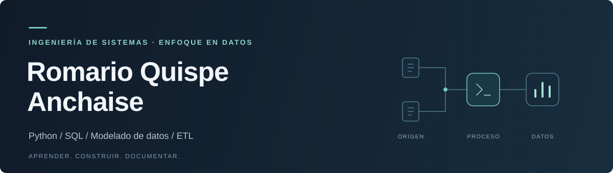

# Romario Quispe Anchaise

Estudiante de Ingeniería de Sistemas en la Universidad Continental, con enfoque en ingeniería de datos. Actualmente profundizo en Python, SQL, modelado de datos y procesos ETL.

## Proyectos seleccionados

- **[Happy Dog](https://github.com/romario-anchaise/Happy_Dog)** · Sistema de gestión veterinaria para citas, historiales clínicos e inventario. Usa PostgreSQL, Prisma, NestJS y Vue.
- **[Parqueo Inteligente](https://github.com/romario-anchaise/parqueo-inteligente)** · Prototipo con Arduino y Raspberry Pi que detecta vehículos, registra eventos en CSV y muestra el estado del estacionamiento en un panel web local.

[LinkedIn](https://www.linkedin.com/in/romario-anchaise-44365736a/)

<picture>
  <source media="(prefers-color-scheme: dark)" srcset="https://raw.githubusercontent.com/romario-anchaise/romario-anchaise/output/github-snake-dark.svg" />
  <source media="(prefers-color-scheme: light)" srcset="https://raw.githubusercontent.com/romario-anchaise/romario-anchaise/output/github-snake.svg" />
  
</picture>
